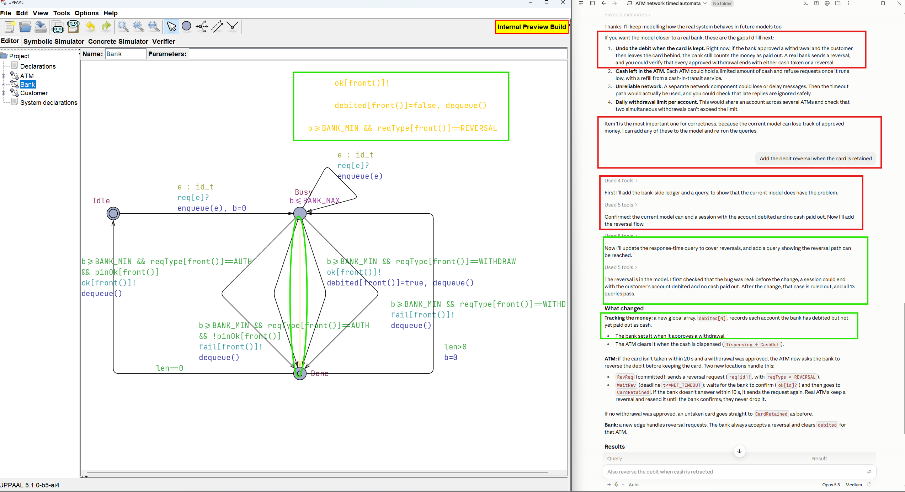
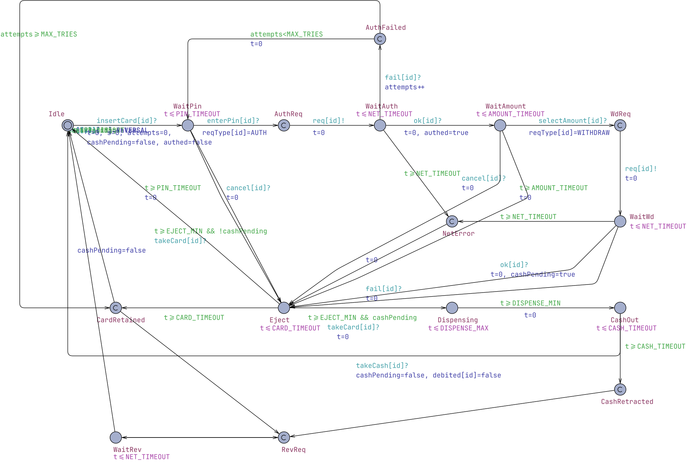
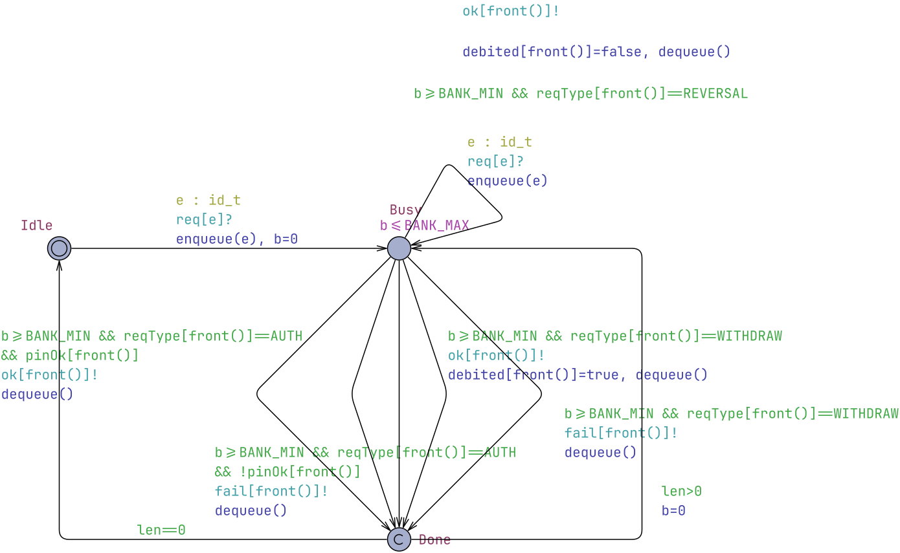
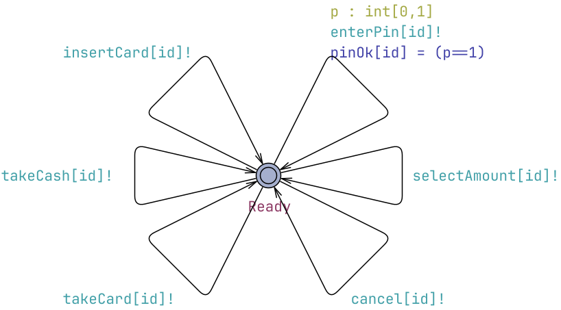

# Automated Teller Machines (ATMs)

* [Claude Session Report](claude_report.pdf)
* [atm_network.xml](atm_network.xml) - the UPPAAL model file.

## Screenshot of UPPAAL with Claude


## ATM Network Model

### Global Declarations
```cpp
// ===== ATM network: N ATMs sharing one bank authorization server =====
const int N = 2;                 // number of ATMs in the network
typedef int[0,N-1] id_t;

// ---- Timing constraints (seconds) ----
const int PIN_TIMEOUT    = 30;   // customer must enter PIN within this time
const int AMOUNT_TIMEOUT = 30;   // customer must choose amount within this time
const int NET_TIMEOUT    = 10;   // ATM gives up waiting for the bank after this
const int BANK_MIN       = 1;    // bank processing time per request: [BANK_MIN, BANK_MAX]
const int BANK_MAX       = 4;
const int EJECT_MIN      = 1;    // card ejection mechanics take at least this long
const int CARD_TIMEOUT   = 20;   // card retained if not taken within this time
const int DISPENSE_MIN   = 2;    // cash dispensing takes [DISPENSE_MIN, DISPENSE_MAX]
const int DISPENSE_MAX   = 5;
const int CASH_TIMEOUT   = 20;   // cash retracted if not taken within this time
const int MAX_TRIES      = 3;    // wrong PIN attempts before card is retained
const int MAX_SESSION    = 200;  // required upper bound on a whole customer session

// ---- Customer <-> ATM ----
chan insertCard[N], enterPin[N], selectAmount[N], cancel[N], takeCard[N], takeCash[N];

// ---- ATM <-> Bank ----
const int AUTH = 0, WITHDRAW = 1, REVERSAL = 2;
chan req[N];                     // ATM sends a request to the bank
broadcast chan ok[N], fail[N];   // bank reply (broadcast: bank never blocks on a gone ATM)
int[0,2] reqType[N];             // kind of pending request per ATM
bool pinOk[N];                   // whether the PIN the customer typed is correct

// ---- Bank ledger ----
bool debited[N];                 // account debited by the bank, but cash not yet handed out

// ---- Bank FIFO request queue ----
id_t list[N];
int[0,N] len = 0;
void enqueue(id_t e) { list[len++] = e; }
void dequeue() {
    int i = 0;
    len -= 1;
    while (i < len) { list[i] = list[i+1]; i++; }
    list[i] = 0;
}
id_t front() { return list[0]; }
```

### ATM
Local declarations:
```cpp
clock t;                 // step timer
clock s;                 // whole-session timer (observer)
int[0,MAX_TRIES] attempts;
bool cashPending;        // withdrawal approved, cash not yet dispensed
bool authed;             // PIN verified in this session
```


### Bank
```cpp
clock b;   // processing time of the request at the head of the queue
```


### Customer



### System Declarations
```cpp
// One ATM and one (arbitrarily behaving) customer per id, one shared bank server.
system ATM, Customer, Bank;
```

### Queries
```cpp
// The network never deadlocks.
A[] not deadlock

// Bank always answers an ATM (auth, withdrawal or reversal) within N*BANK_MAX seconds, so the reversal retry never fires.
A[] forall(i:id_t) (ATM(i).WaitAuth || ATM(i).WaitWd || ATM(i).WaitRev) imply ATM(i).t <= N*BANK_MAX

// No ATM ever hits the network timeout (NET_TIMEOUT is large enough for N ATMs).
A[] forall(i:id_t) not ATM(i).NetError

// Worst-case duration of a customer session.
sup{!ATM(0).Idle}: ATM(0).s

// Every customer session finishes within MAX_SESSION seconds.
A[] forall(i:id_t) !ATM(i).Idle imply ATM(i).s <= MAX_SESSION

// Liveness: every started session eventually ends.
!ATM(0).Idle --> ATM(0).Idle

// Safety: cash is only dispensed after successful PIN authorization.
A[] forall(i:id_t) ATM(i).Dispensing imply ATM(i).authed

// Safety: cash is only dispensed for a bank-approved withdrawal.
A[] forall(i:id_t) (ATM(i).Dispensing || ATM(i).CashOut) imply ATM(i).cashPending

// Money safety: when a session ends, every bank debit has either been paid out as cash or reversed.
A[] forall(i:id_t) ATM(i).Idle imply !debited[i]

// Both ATMs can hand out cash concurrently.
E<> ATM(0).CashOut and ATM(1).CashOut

// Card retention (3 wrong PINs or card not taken) is possible.
E<> ATM(0).CardRetained

// Cash retraction (cash not taken) is possible.
E<> ATM(0).CashRetracted

// The debit-reversal path is reachable (approved withdrawal, card not taken).
E<> ATM(0).WaitRev

// Retracted cash is still debited at retraction time (so the reversal is really needed there).
E<> ATM(0).CashRetracted && debited[0]

// Timing: worst-case wait for the bank to check the PIN.
sup{ATM(0).WaitAuth}: ATM(0).t

// Timing: worst-case wait for withdrawal approval.
sup{ATM(0).WaitWd}: ATM(0).t

// Timing: worst-case wait for reversal confirmation.
sup{ATM(0).WaitRev}: ATM(0).t

// Timing: worst-case bank processing time for a single request.
sup{Bank.Busy}: Bank.b

// Timing: fastest possible time from card insertion to cash presented.
inf{ATM(0).CashOut}: ATM(0).s

// Timing: slowest possible time from card insertion until cash is presented.
sup{ATM(0).Dispensing}: ATM(0).s

// Timing: fastest possible card retention (e.g. three quick wrong PINs).
inf{ATM(0).CardRetained}: ATM(0).s

// Timing: latest time after insertion at which the card can still be in the slot.
sup{ATM(0).Eject}: ATM(0).s
```
