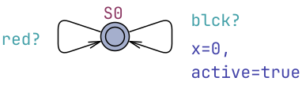
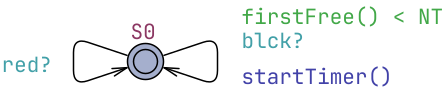
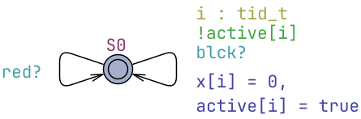
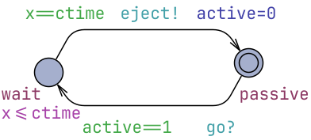
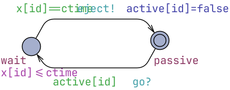
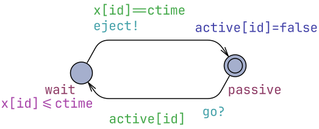
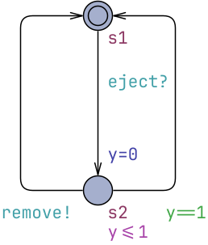
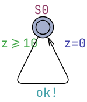
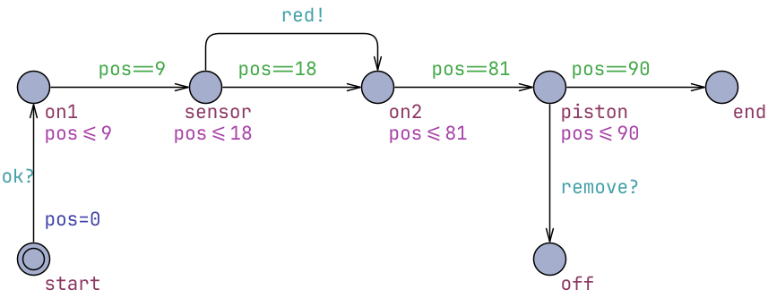
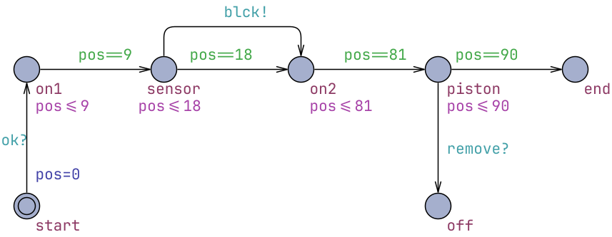

# Box Sorting Conveyor Belt

* [Claude Session Report](claude_report.pdf)
* [boxesARTES06.xml](boxesARTES06.xml) original model with one box at a time as presented at [ARTES 2006 summer school](https://www.artes.uu.se/events/summer06/kimgl.shtml). Contains buffer-overflow vulnerability triggered by too many boxes on belt. The fix has not been published before.
* [FixedBoxesBig.xml](FixedBoxesBig.xml) fixed buffer-overflow by Claude (contains state space explosion due to 8 boxes).
* [BigBoxesSymmetric.xml](BigBoxesSymmetric.xml) state space reduced by symmetry reduction applied by Claude.

| Part     | Original model | Fixed buffer overflow | Symmetry reduction |
|----------|----------------|-----------------------|--------------------|
| TaskMAIN |  |  |  |
| TaskPUSH |  |  |  |
| Piston |  |  |  |
| Dumb |  |  |  |
| Guard |  |  |  |
| RedBox |  |  |  |
| BlackBox |  |  |  |

## Original Global Declarations
```cpp
const int ctime = 75;

int[0,1] active;
clock x, time;

chan   eject, ok;
urgent chan blck, red, remove, go;
```

### Fixed Global Declarations

```cpp
const int ctime = 75;

// Fix: one eject timer per black box that can be in transit between the
// sensor and the piston (previously a single timer x was reset by every
// detection, overwriting the pending eject of an earlier black box).
// Boxes are placed >= 10 apart and travel 75 from sensor to piston, so at
// most 8 black boxes can be in transit at once: 8 timers always suffice.
const int NT = 8;               // number of eject timers
typedef int[0,NT-1] tid_t;

bool  active[NT];               // timer i is counting down to an eject
clock x[NT];                    // timer i: time since its black box was sensed
clock time;

chan   eject, ok;
urgent chan blck, red, remove, go;

// index of a free timer, or NT if all are busy
int[0,NT] firstFree() {
    for (i : tid_t)
        if (!active[i]) return i;
    return NT;
}

// start the first free timer for a newly sensed black box
void startTimer() {
    int i = firstFree();
    x[i] = 0;
    active[i] = true;
}
```

## Reduced Symmetries Global Declarations

```cpp
const int ctime = 75;

// Fix: one eject timer per black box that can be in transit between the
// sensor and the piston (previously a single timer x was reset by every
// detection, overwriting the pending eject of an earlier black box).
// Boxes are placed >= 10 apart and travel 75 from sensor to piston, so at
// most 8 black boxes can be in transit at once: 8 timers always suffice.
const int NT = 8;               // number of eject timers
const int NB = 5;               // number of black boxes
const int NR = 3;               // number of red boxes

// Scalar sets: identical boxes/timers are interchangeable, which lets
// UPPAAL apply symmetry reduction.
typedef scalar[NT] tid_t;
typedef scalar[NB] bid_t;
typedef scalar[NR] rid_t;

bool  active[tid_t];            // timer i is counting down to an eject
clock x[tid_t];                 // timer i: time since its black box was sensed

chan   eject, ok;
urgent chan blck, red, remove, go;
```
