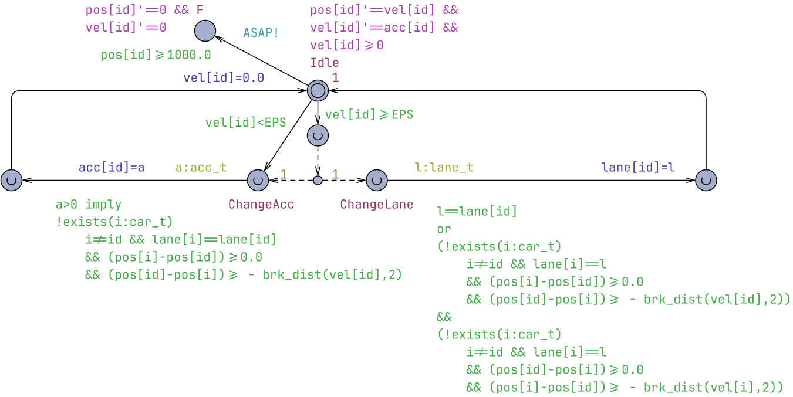
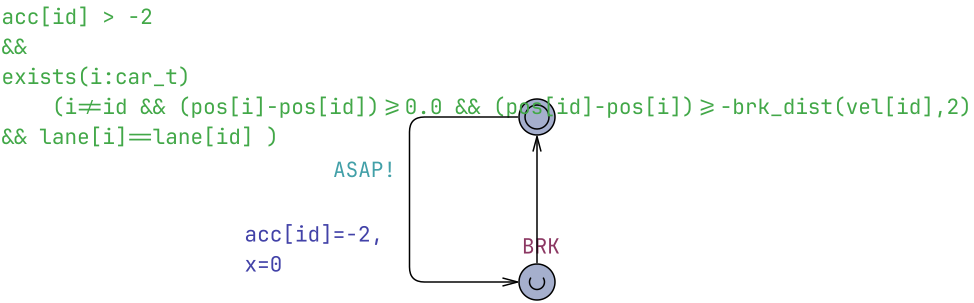
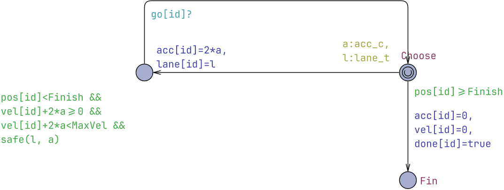
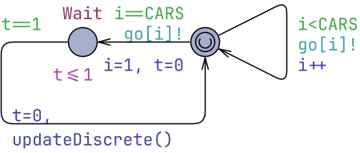
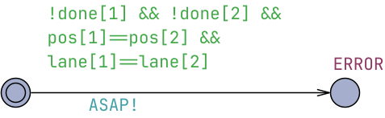

# Collision-Free Lane Changing

* [Claude Session Report](claude_report.pdf)
* [IntCars13.xml](IntCars13.xml) - the original (bogus) model.
* [Claude bug analysis report](IntCars13-bug-analysis.html)
* [Claude collision fix report](IntCars13-collision-fix.md)
* [IntCars-UPPAAi-Fixed.xml](IntCars-UPPAAi-Fixed.xml) - the fixed model by Claude.


## Original (bogus) Model

Model file: [IntCars13.xml](IntCars13.xml)

### Global Declarations
```cpp
const double EPS=1e-3;
const int LANES = 3;
const int CARLENGTH=20;
const double BRKLENGTH=700.0;
// 300 is a good BRKLENGTH -- 100 not sufficient.
typedef int[0,LANES-1] lane_t;
const int LANE_WIDTH = 2000;
const int CARS = 2;
typedef int[1,CARS] car_t;
typedef int[-2,2] acc_t;

lane_t lane[car_t]={0,2};
hybrid clock pos[car_t];
hybrid clock vel[car_t];
acc_t acc[car_t];

bool RL[lane_t];

urgent broadcast chan ASAP;
clock time;
clock x;

double brk_dist(double v,  int a)
{ return (v*v)/(2*a)+1.0; }
```

### Car
Local declarations:
```cpp
lane_t tmp_lane;
acc_t tmp_acc;
```


### Decisions



### Safety Monitor


### System Declarations
```cpp
system CarCtr2, DC, Monitor;
```

## Fixed Model
Model file: [IntCars-UPPAAi-Fixed.xml](IntCars-UPPAAi-Fixed.xml)

### Global Declarations
```cpp
const int MaxVel = 20;
const int CARS = 2;
const int LANES = 1;
typedef int[0,LANES-1] lane_t;
typedef int[1,CARS] car_t;
typedef int[-1,1] acc_c;
typedef int[-2,2] acc_t;
const int Finish=700;   // use e.g. 100 for exhaustive model checking (A[], E<>)


lane_t lane[car_t]={0,0};
acc_t acc[car_t];

int vel[car_t];
int pos[car_t]={0,10};
bool done[car_t];   // car has passed Finish and left the road

broadcast chan go[car_t];  /// signal to Car(i) to decide
urgent broadcast chan ASAP;

int bd[car_t];
// Distance travelled when braking with deceleration a until standstill.
// With the discrete update below (pos += v-1, v -= 2 per step) braking from
// an even velocity v covers exactly v*v/4 = brk_dist(v,2).
int brk_dist(int v,  int a) { return (v*v)/(2*a);}

// Position where car with position p and velocity v comes to rest when braking
int stop_pos(int p, int v) { return p + brk_dist(v,2); }

// Estimate velocities and distance using integers after 1s
void updateDiscrete() {
for  (i : car_t)
{
    pos[i] = pos[i] + vel[i] + acc[i]/2;
    vel[i] = vel[i] + acc[i];
    bd[i] = brk_dist(vel[i],2);
}
}

clock time;
```

### Car
Local declarations:
```cpp
// Safety invariant between a follower f and a leader l on the same lane:
//    pos[f] < pos[l]  and  stop_pos(f) < stop_pos(l)
// If it holds, the follower can always keep it by braking, whatever the
// leader does (the leader's stop_pos never decreases).

// Car j is in front of id on the target lane: id's choice a must be safe
// against the worst case for j, i.e. j braking fully in this step.
bool safe_front(car_t j, int a) {
    int np = pos[id] + vel[id] + a;
    int nv = vel[id] + 2*a;
    int jp = pos[j] + (vel[j] >= 2 ? vel[j] - 1 : 0);   // j brakes
    return np < jp && stop_pos(np, nv) < stop_pos(pos[j], vel[j]);
}

// Car j is behind id on a lane id is moving into: the invariant must hold now
// (so j can still brake) and after the step even if j accelerates maximally.
bool safe_back(car_t j, int a) {
    int np = pos[id] + vel[id] + a;
    int nv = vel[id] + 2*a;
    int aj = (vel[j] + 2 < MaxVel) ? 1 : 0;              // j accelerates
    int jp = pos[j] + vel[j] + aj;
    int jv = vel[j] + 2*aj;
    return stop_pos(pos[j], vel[j]) < stop_pos(pos[id], vel[id])
        && jp < np && stop_pos(jp, jv) < stop_pos(np, nv);
}

// Choosing acceleration 2*a and lane l is safe w.r.t. all other cars on l
bool safe(lane_t l, int a) {
    for (j : car_t) {
        if (j != id && !done[j] && lane[j] == l) {
            if (pos[j] > pos[id]) {
                if (!safe_front(j, a)) return false;
            } else if (pos[j] == pos[id]) {
                return false;
            } else if (l != lane[id]) {
                if (!safe_back(j, a)) return false;
            }
        }
    }
    return true;
}
```


### Decisions
Local declarations:
```cpp
clock t;
car_t i;
```


### Safety Monitor


