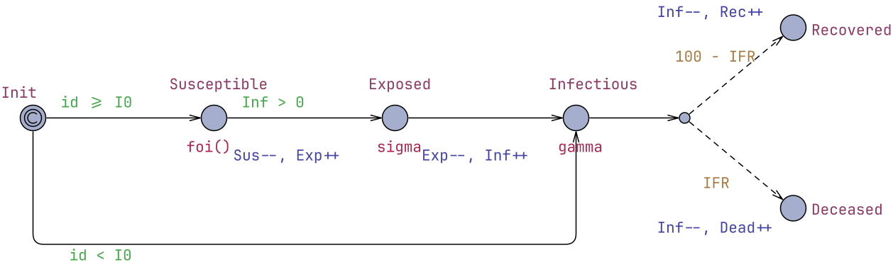
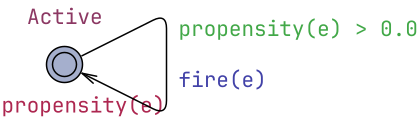
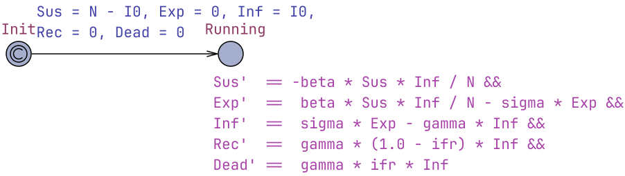

# COVID-19 Epidemic Models

* [Claude Session Report](claude_report.pdf)
* [CovidAgentBased.xml](CovidAgentBased.xml) - agent-based model (generated by Claude)
* [CovidCTMC.xml](CovidCTMC.xml) - CTMC-based model (refactored/generated by Claude)
* [CovidODE.xml](CovidODE.xml) - ODE-based model (refactored/generated by Claude)

## Agent-Based Model

Model file: [CovidAgentBased.xml](CovidAgentBased.xml)

### Global Declarations

```cpp
// Stochastic agent-based SEIRD model of COVID-19 spreading in a closed,
// well-mixed population. One Person process per individual. Time unit: days.
// Analyse with UPPAAL SMC (statistical model checking).

// ---------------- Population ----------------
const int N  = 100;             // population size (change freely)
const int I0 = 1;               // initially infectious individuals
typedef int[0, N-1] id_t;

// ---------------- Epidemiological parameters ----------------
const double R0      = 2.5;           // basic reproduction number
const double gamma   = 1.0 / 7.0;     // recovery rate   (mean infectious period 7 days)
const double sigma   = 1.0 / 5.2;     // incubation rate (mean latent period 5.2 days)
const double beta    = R0 * gamma;    // transmission rate per infectious contact-day
const int    IFR     = 1;             // infection fatality: IFR out of 100 (1%)

// ---------------- Compartment counters ----------------
int Sus  = N - I0;              // susceptible
int Exp  = 0;                   // exposed (infected, not yet infectious)
int Inf  = I0;                  // infectious
int Rec  = 0;                   // recovered (immune)
int Dead = 0;                   // deceased

// Force of infection on a single susceptible: beta * I / N
double foi() { return beta * Inf / N; }
```

### Person Template
Parameters:
```cpp
const id_t id
```


### System Declarations
```cpp
// One Person process per individual id in [0, N-1].
system Person;
```

### Query
```cpp
// One simulated epidemic trajectory over 180 days (plot all compartments).
simulate [<=180; 1] { Sus, Exp, Inf, Rec, Dead }

// Ten trajectories of the number of infectious people: shows the run-to-run variability.
simulate [<=180; 10] { Inf }

// Expected peak number of simultaneously infectious people.
E [<=365; 500] (max: Inf)

// Expected number of deaths within one year.
E [<=365; 500] (max: Dead)

// Probability that at least half the population is infected within a year (a major outbreak).
Pr [<=365] (<> Rec + Dead >= N / 2)

// Probability that 20% of the population is infectious at the same time (e.g. exceeding healthcare capacity).
Pr [<=365] (<> Inf >= N / 5)

// Probability of early stochastic extinction: the epidemic dies out before infecting 10% of the population.
Pr [<=365] (<> Exp + Inf == 0 && Rec + Dead < N / 10)

// Sanity check: the compartments always sum to the population size (should be ~1).
Pr [<=365] ([] Sus + Exp + Inf + Rec + Dead == N)
```

## CTMC-Based Model
Model file: [CovidCTMC.xml](CovidCTMC.xml)

### Global Declarations
```cpp
// SEIRD model of COVID-19 spreading as a Continuous Time Markov Chain (CTMC).
// The state is the vector of compartment counts (S, E, I, R, D); each event
// type (reaction) is a Reaction process whose single location has an
// exponential exit rate equal to the event's propensity. UPPAAL SMC's race
// semantics between these processes is exactly the CTMC (Gillespie) dynamics.
// Time unit: days.

// ---------------- Population ----------------
const int N  = 100;             // population size (change freely)
const int I0 = 1;               // initially infectious individuals

// ---------------- Epidemiological parameters ----------------
const double R0    = 2.5;             // basic reproduction number
const double gamma = 1.0 / 7.0;       // recovery rate   (mean infectious period 7 days)
const double sigma = 1.0 / 5.2;       // incubation rate (mean latent period 5.2 days)
const double beta  = R0 * gamma;      // transmission rate
const double ifr   = 0.01;            // infection fatality ratio (1%)

// ---------------- CTMC state ----------------
int Sus  = N - I0;              // susceptible
int Exp  = 0;                   // exposed (infected, not yet infectious)
int Inf  = I0;                  // infectious
int Rec  = 0;                   // recovered (immune)
int Dead = 0;                   // deceased

// ---------------- Transitions of the CTMC ----------------
//   INFECTION : S + I -> E + I   rate beta * S * I / N
//   ONSET     : E     -> I       rate sigma * E
//   RECOVERY  : I     -> R       rate gamma * (1 - ifr) * I
//   DEATH     : I     -> D       rate gamma * ifr * I
const int INFECTION = 0;
const int ONSET     = 1;
const int RECOVERY  = 2;
const int DEATH     = 3;
typedef int[0, 3] ev_t;

double propensity(ev_t e) {
    if (e == INFECTION) return beta * Sus * Inf / N;
    if (e == ONSET)     return sigma * Exp;
    if (e == RECOVERY)  return gamma * (1.0 - ifr) * Inf;
    return gamma * ifr * Inf;   // DEATH
}

void fire(ev_t e) {
    if (e == INFECTION)     { Sus--; Exp++; }
    else if (e == ONSET)    { Exp--; Inf++; }
    else if (e == RECOVERY) { Inf--; Rec++; }
    else                    { Inf--; Dead++; }
}
```

### Reaction Template
Parameters:
```cpp
const ev_t e
```


### System Declarations
```cpp
// One Reaction process per CTMC event type. Model size no longer depends on N.
system Reaction;
```

### Queries
```cpp
// One simulated epidemic trajectory over 180 days (plot all compartments).
simulate [<=180; 1] { Sus, Exp, Inf, Rec, Dead }

// Ten trajectories of the number of infectious people: shows the run-to-run variability.
simulate [<=180; 10] { Inf }

// Expected peak number of simultaneously infectious people.
E [<=365; 500] (max: Inf)

// Expected number of deaths within one year.
E [<=365; 500] (max: Dead)

// Probability that at least half the population is infected within a year (a major outbreak).
Pr [<=365] (<> Rec + Dead >= N / 2)

// Probability that 20% of the population is infectious at the same time (e.g. exceeding healthcare capacity).
Pr [<=365] (<> Inf >= N / 5)

// Probability of early stochastic extinction: the epidemic dies out before infecting 10% of the population.
Pr [<=365] (<> Exp + Inf == 0 && Rec + Dead < N / 10)

// Sanity check: the compartments always sum to the population size (should be ~1).
Pr [<=365] ([] Sus + Exp + Inf + Rec + Dead == N)
```

## ODE-Based Model
Model file: [CovidODE.xml](CovidODE.xml)

### Global Declarations
```cpp
// Deterministic SEIRD model of COVID-19 spreading as a system of ODEs:
//   dS/dt = -beta * S * I / N
//   dE/dt =  beta * S * I / N - sigma * E
//   dI/dt =  sigma * E - gamma * I
//   dR/dt =  gamma * (1 - ifr) * I
//   dD/dt =  gamma * ifr * I
// The compartments are clocks whose derivatives are given in the invariant
// of the Running location; UPPAAL SMC integrates them numerically.
// Time unit: days.

// ---------------- Population ----------------
const int N  = 100;             // population size (change freely)
const int I0 = 1;               // initially infectious individuals

// ---------------- Epidemiological parameters ----------------
const double R0    = 2.5;             // basic reproduction number
const double gamma = 1.0 / 7.0;       // recovery rate   (mean infectious period 7 days)
const double sigma = 1.0 / 5.2;       // incubation rate (mean latent period 5.2 days)
const double beta  = R0 * gamma;      // transmission rate
const double ifr   = 0.01;            // infection fatality ratio (1%)

// ---------------- Continuous state (real-valued compartments) ----------------
clock Sus, Exp, Inf, Rec, Dead;
```

### SEIRD Template


### System Declarations
```cpp
system SEIRD;
```

### Queries
```cpp
// The (deterministic) epidemic curves over 180 days.
simulate [<=180] { Sus, Exp, Inf, Rec, Dead }

// Peak number of simultaneously infectious people (deterministic: the CI should have width 0).
E [<=365; 2] (max: Inf)

// Deaths within one year.
E [<=365; 2] (max: Dead)

// Final epidemic size: total number ever infected within one year.
E [<=365; 2] (max: Rec + Dead)

// Does the number of infectious people reach 20% of the population? (0 or 1, the model is deterministic.)
Pr [<=365] (<> Inf >= N / 5)

// Sanity check: total population is conserved (should be N up to integration error).
E [<=365; 2] (max: Sus + Exp + Inf + Rec + Dead)
```
