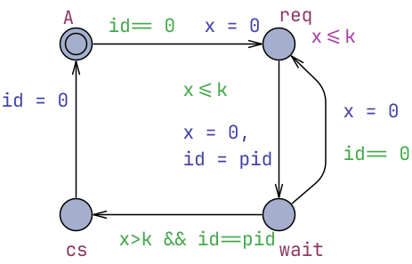

# Fischer's Mutual Exclusion Protocol

* [Newcomer's Report](newcomer_report.pdf)
* [Claude Session Report](claude_report.pdf)
* [fischer.xml](fischer.xml) model, the same as in UPPAAL Examples menu.

## Global Declarations
```cpp
typedef int[1,6] id_t;
int id;
```

## Process Template `P`
Parameters:
```cpp
const id_t pid
```

Local declarations:
```cpp
clock x;
const int k = 2;
```


## System Declarations
```cpp
system P;
```

## Queries
```cpp
// Mutex requirement.
A[] forall (i:id_t) forall (j:id_t) P(i).cs && P(j).cs imply i == j

// The system is deadlock free.
A[] not deadlock

// Whenever P(1) requests access to the critical section it will eventually enter the wait state.
P(1).req --> P(1).wait
```
