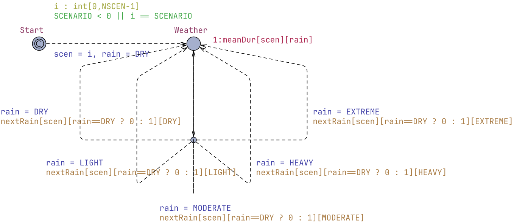
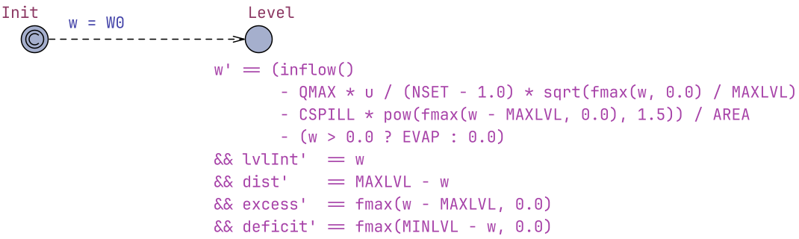
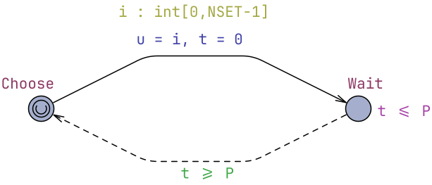

# Storm Water Detention Ponds

* [Claude Session Report](claude_report.pdf)
* [StormWater.xml](StormWater.xml)

## Model
Model file: [StormWater.xml](StormWater.xml)

### Global Declarations
```cpp
/* ================================================================
   Storm water detention pond -- UPPAAL Stratego model
   Time unit: minute.  Level unit: metre.  Volume unit: m^3.
   ================================================================ */

// ---------- horizon and control period ----------
const int H = 1440;          // horizon used for learning / evaluation (1 day)
const int P = 30;            // controller period (minutes)

// ---------- pond geometry and level limits ----------
const double AREA   = 5000.0;   // pond surface area (m^2), vertical banks assumed
const double MINLVL = 1.0;      // minimum (ecological) level (m)
const double MAXLVL = 2.5;      // maximum level = crest of emergency spillway (m)
const double W0     = 1.5;      // initial level (m)

// ---------- catchment ----------
const double CATCH = 180000.0;  // effective catchment area (m^2) = area * runoff coefficient
const double EVAP  = 0.00005;   // evaporation + infiltration loss (m/min), ~7 cm/day

// ---------- outlet and spillway ----------
const int    NSET   = 4;        // outlet settings 0 (closed), 1 (1/3), 2 (2/3), 3 (fully open)
const double QMAX   = 120.0;    // outflow of fully open outlet at level MAXLVL (m^3/min) = 2 m^3/s
const double CSPILL = 600.0;    // emergency spillway coefficient (m^3/min per m^1.5)

int[0,NSET-1] u = 0;            // current outlet setting (chosen by the controller)

// ---------- rain ----------
const int DRY = 0, LIGHT = 1, MODERATE = 2, HEAVY = 3, EXTREME = 4;
const int NRAIN = 5;
int[0,NRAIN-1] rain = DRY;      // current rain class

// rain intensity per class (mm/h)
const double intensity[NRAIN] = { 0.0, 2.0, 8.0, 25.0, 60.0 };

// ---------- rain scenarios ----------
// 0: dry summer   1: normal   2: wet autumn   3: cloudburst (convective storms)
const int NSCEN    = 4;
const int SCENARIO = -1;        // -1: scenario drawn uniformly at start, 0..3: fixed scenario
int[0,NSCEN-1] scen = 0;

// mean sojourn time (minutes) in each rain class, per scenario (exponentially distributed)
const int meanDur[NSCEN][NRAIN] = {
    { 1440,  60,  45, 30, 15 },   // dry summer
    {  480, 120,  60, 40, 20 },   // normal
    {  180, 240, 120, 60, 20 },   // wet autumn
    {  720,  60,  45, 30, 20 }    // cloudburst
};

// weights of the next rain class, per scenario, from dry weather [0] or from rain [1]
const int nextRain[NSCEN][2][NRAIN] = {
    { {  0, 80, 15,  5,  0 }, { 70, 20,  8,  2,  0 } },   // dry summer
    { {  0, 50, 35, 12,  3 }, { 50, 25, 15,  8,  2 } },   // normal
    { {  0, 30, 45, 20,  5 }, { 25, 30, 30, 12,  3 } },   // wet autumn
    { {  0, 20, 25, 30, 25 }, { 55, 10, 10, 15, 10 } }    // cloudburst
};

// inflow from the urban catchment (m^3/min): mm/h -> m/min is /60000
double inflow() { return CATCH * intensity[rain] / 60000.0; }

// ---------- continuous state and cost monitors ----------
hybrid clock w;        // water level (m)
hybrid clock lvlInt;   // integral of the level            (average level = lvlInt / time)
hybrid clock dist;     // integral of (MAXLVL - w)         (optimality: minimise)
hybrid clock excess;   // integral of max(w - MAXLVL, 0)   (overflow severity: safety)
hybrid clock deficit;  // integral of max(MINLVL - w, 0)   (below minimum level)
clock time;

// penalty weights used in the learning objective
const double PEN_OVER  = 10000.0;
const double PEN_UNDER = 100.0;
```

### Rain Template


### Pond Template


### Controller Template
Local declarations:
```cpp
clock t;   // time since last decision
```


### System Declarations
```cpp
system Rain, Pond, Controller;
```

### Queries
```cpp
// Random outlet choices (no strategy): level, limits, outlet setting and rain class (scaled).
simulate [<=H] { w, MINLVL, MAXLVL, u * 0.5, rain * 0.5 }

// Baseline (random outlet): expected average water level.
E[<=H; 1000] (max: lvlInt / H)

// Baseline (random outlet): probability of exceeding the maximum level.
Pr[<=H] (<> excess > 0.0)

// Learn a periodic controller: observes the rain class and the water level at each decision; minimises the integral of (max level - level) with heavy penalties for exceeding the max level and for dropping below the min level.
strategy Opt = minE (dist + PEN_OVER * excess + PEN_UNDER * deficit) [<=H] { rain } -> { w } : <> time >= H

// Save the learned strategy Opt to a file (run right after learning).
saveStrategy("pond_Opt.json", Opt)

// Reload Opt from file instead of re-learning (only valid if the model has not changed since it was saved).
strategy Opt = loadStrategy { rain } -> { w } ("pond_Opt.json")

// Simulate the learned controller.
simulate [<=H] { w, MINLVL, MAXLVL, u * 0.5, rain * 0.5 } under Opt

// Learned controller: expected average water level.
E[<=H; 1000] (max: lvlInt / H) under Opt

// Learned controller: probability of exceeding the maximum level (overflow).
Pr[<=H] (<> excess > 0.0) under Opt

// Learned controller: probability of dropping below the minimum level.
Pr[<=H] (<> deficit > 0.0) under Opt

// Learned controller: expected overflow severity (integral of excess level above MAXLVL, m*min).
E[<=H; 1000] (max: excess) under Opt

// Joint probability of the cloudburst scenario and an overflow (divide by 0.25 when SCENARIO = -1).
Pr[<=H] (<> excess > 0.0 && scen == 3) under Opt
```
