# Time-Sensitive Networks (TSN)

* [Publication about TSN](Formal_Scheduling_Constraints_for_Time-Sensitive_Networks.pdf)
* [Claude Session Report](claude_report.pdf)
* [tsn_qbv.xml](tsn_qbv.xml) for symbolic model-checking (MC)
* [tsn_qbv_smc.xml](tsn_qbv_smc.xml) for statistical model checking (SMC)

## Overview of Both Models
| Template  | MC ([tsn_qbv.xml](tsn_qbv.xml)) | SMC ([tsn_qbv_smc.xml](tsn_qbv_smc.xml)) |
|-----------|----|-----|
|NodeClock  | 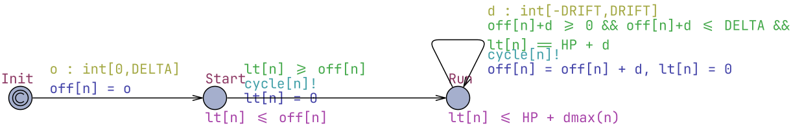 | 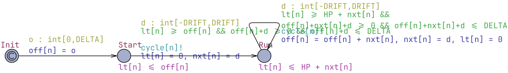 |
| Source    | 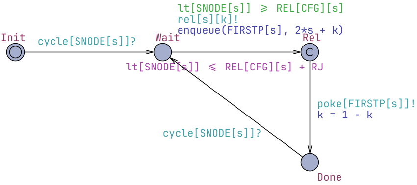 |  |
| Gate      | 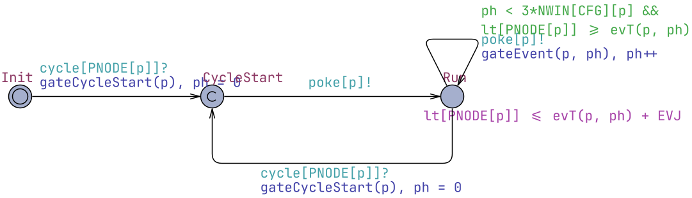 |  |
| Scheduler | 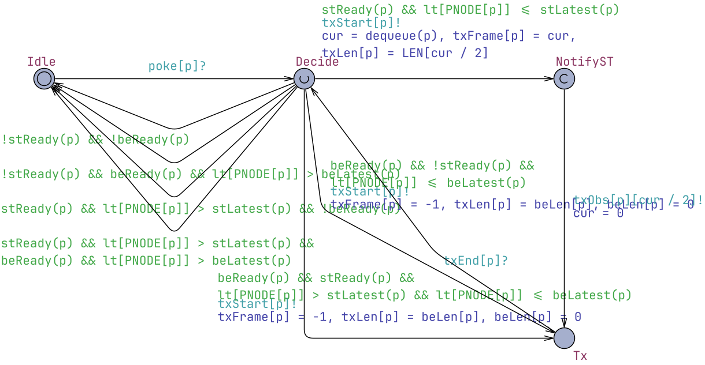 |  |
| Medium    | 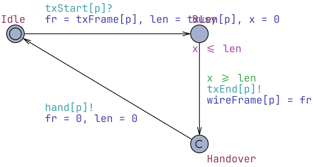 |  |
| Wire      | 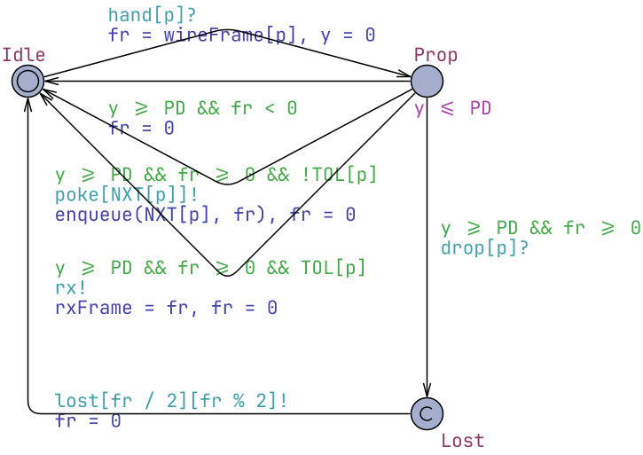  |  |
| Receiver  | 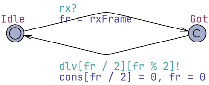 |  |
| BESource  | 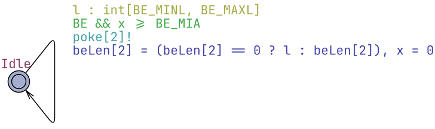 | 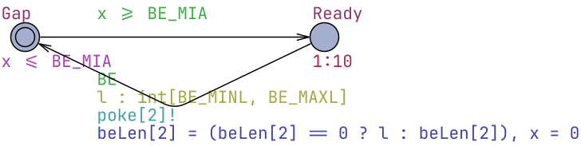 |
| FaultEnvironment | 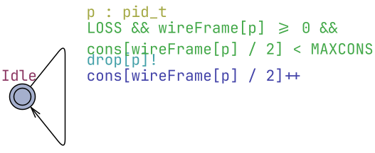 | 
| Observer  |  | 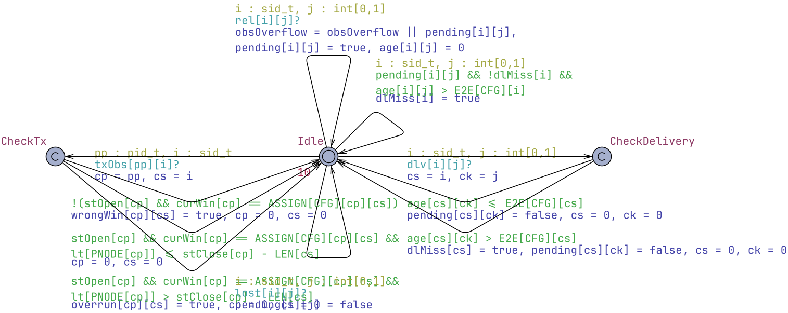 |


## Symbolic Model Checking

Model file: [tsn_qbv.xml](tsn_qbv.xml) 

### Global Declarations
```cpp
// =====================================================================
//  IEEE 802.1Qbv time-aware shaper: robustness of window-based GCL schedules
//  Constraints follow Craciunas, Serna Oliver, Steiner,
//  "Formal Scheduling Constraints for Time-Sensitive Networks" (arXiv:1712.02246)
//
//  Bounded topology:   T1 --P0--> SW --P2--> L        (stream s0)
//                      T2 --P1--> SW                   (stream s1)
//  One scheduled (ST) queue per egress port, plus a best-effort (BE) queue
//  on P2. All streams share the period HP (paper, Section 3). 1 tick = 1 time unit.
// =====================================================================

// ---------------- analysis knobs (vary these) ------------------------
const int  CFG     = 0;     // GCL: 0 shared SW window | 1 two SW windows, NO isolation | 2 two SW windows, time isolation
const int  DELTA   = 2;     // ACTUAL bound on pairwise clock offset between nodes
const int  DRIFT   = 0;     // max change of a node offset per cycle (0 = constant offset in a run)
const int  RJ      = 0;     // release jitter of talker applications
const bool LOSS    = false; // frame loss on links
const int  MAXCONS = 1;     // max number of consecutive lost instances of a stream
const bool BE      = false; // best-effort interference at SW egress P2
const int  BE_MINL = 4;     // BE frame transmission time range
const int  BE_MAXL = 8;
const int  BE_MIA  = 20;    // BE minimum inter-arrival time
const int  GB      = 0;     // guard band: BE gate closes GB before each ST window
const bool LA      = true;  // length-aware selection: start only if frame ends before gate closes
const int  EVJ     = 0;     // NAIVE alternative clock model: each gate event independently late by up to EVJ (0 = off)

// ---------------- fixed design data ---------------------------------
const int HP     = 100;     // cycle = hyperperiod
const int PD     = 2;       // propagation + store-and-forward delay per hop
const int DSCHED = 2;       // precision delta assumed when the GCL was synthesised
const int BIG    = 1000;

const int S = 2;  typedef int[0,S-1] sid_t;   // streams s0: T1->L, s1: T2->L
const int P = 3;  typedef int[0,P-1] pid_t;   // egress ports P0=[T1,SW] P1=[T2,SW] P2=[SW,L]
const int N = 3;  typedef int[0,N-1] nid_t;   // clocked nodes 0=T1 1=T2 2=SW
const int NWMAX = 2;
const int NCFG  = 3;

const int   LEN[S]    = {10, 10};               // max frame size -> transmission time
const nid_t PNODE[P]  = {0, 1, 2};              // node owning the egress port
const pid_t NXT[P]    = {2, 2, 0};              // downstream egress port (if !TOL)
const bool  TOL[P]    = {false, false, true};   // port leads to the listener
const pid_t FIRSTP[S] = {0, 1};
const nid_t SNODE[S]  = {0, 1};

// Gate control lists: scheduled windows [open,close) per port, local cycle time
const int NWIN[NCFG][P]          = { {1,1,1}, {1,1,2}, {1,1,2} };
const int WOPEN[NCFG][P][NWMAX]  = { {{10,0},{10,0},{24,0}},
                                     {{10,0},{10,0},{24,34}},
                                     {{10,0},{34,0},{24,48}} };
const int WCLOSE[NCFG][P][NWMAX] = { {{20,0},{20,0},{44,0}},
                                     {{20,0},{20,0},{34,44}},
                                     {{20,0},{44,0},{34,58}} };
// frame-to-window assignment w_k.phi(f_i): window index, -1 = stream not on port
const int ASSIGN[NCFG][P][S]     = { {{0,-1},{-1,0},{0,0}},
                                     {{0,-1},{-1,0},{0,1}},
                                     {{0,-1},{-1,0},{0,1}} };
const int REL[NCFG][S] = { {0,0}, {0,0}, {0,24} };      // nominal release (talker local time)
const int E2E[NCFG][S] = { {48,48}, {38,48}, {38,38} }; // end-to-end deadline

// ---------------- node clocks ---------------------------------------
clock lt[N];                 // local time since the node's current cycle start
int   off[N];                // node offset w.r.t. the ideal cycle start
broadcast chan cycle[N];

int dmax(nid_t n) { return DRIFT < DELTA - off[n] ? DRIFT : DELTA - off[n]; }

// ---------------- queues (FIFO data structures) ---------------------
const int QCAP = 3;
int q[P][QCAP];              // ST frame ids: f = 2*s + seq
int[0,QCAP] qlen[P];
bool qOverflow = false;
int beLen[P];                // waiting BE frame (length, 0 = none); capacity 1, tail drop

void enqueue(pid_t p, int f) {
    if (qlen[p] == QCAP) { qOverflow = true; }
    else { q[p][qlen[p]] = f; qlen[p]++; }
}
int dequeue(pid_t p) {
    int f = q[p][0], i;
    for (i = 0; i < QCAP - 1; i++) q[p][i] = q[p][i+1];
    q[p][QCAP-1] = 0;
    qlen[p]--;
    return f;
}

// ---------------- gates (driven by the GCL) -------------------------
bool stOpen[P], beOpen[P];
int  curWin[P] = {-1, -1, -1};   // index of the open ST window, -1 = closed
int  stClose[P], beClose[P];     // local time at which the current open phase ends

// event ph of a cycle: per window w three events (BE close, ST open, ST close/BE open)
int evT(pid_t p, int ph) {
    int w = ph / 3, k = ph % 3, t;
    if (ph >= 3 * NWIN[CFG][p]) return BIG;
    if (k == 0) {
        t = WOPEN[CFG][p][w] - GB;
        if (w > 0 && t < WCLOSE[CFG][p][w-1]) t = WCLOSE[CFG][p][w-1];
        if (t < 0) t = 0;
        return t;
    }
    if (k == 1) return WOPEN[CFG][p][w];
    return WCLOSE[CFG][p][w];
}
void gateEvent(pid_t p, int ph) {
    int w = ph / 3, k = ph % 3;
    if (k == 0) { beOpen[p] = false; }
    else if (k == 1) { stOpen[p] = true; curWin[p] = w; stClose[p] = WCLOSE[CFG][p][w]; }
    else {
        stOpen[p] = false; curWin[p] = -1;
        beClose[p] = (w + 1 < NWIN[CFG][p]) ? evT(p, 3 * (w + 1)) : HP;
        beOpen[p] = beClose[p] > WCLOSE[CFG][p][w];
    }
}
void gateCycleStart(pid_t p) {
    stOpen[p] = false; curWin[p] = -1;
    beClose[p] = evT(p, 0); beOpen[p] = beClose[p] > 0;
}

// ---------------- transmission selection ----------------------------
bool stReady(pid_t p) { return stOpen[p] && qlen[p] > 0; }
bool beReady(pid_t p) { return beOpen[p] && beLen[p] > 0; }
int  stLatest(pid_t p) { return LA ? stClose[p] - LEN[q[p][0] / 2] : BIG; }  // latest start of head ST frame
int  beLatest(pid_t p) { return LA ? beClose[p] - beLen[p] : BIG; }

broadcast chan poke[P];      // "re-evaluate selection" (gate opened, frame arrived)
chan txStart[P], txEnd[P], hand[P], drop[P], rx;
int  txFrame[P], txLen[P], wireFrame[P], rxFrame;   // value passing (-1 = BE frame)
int  cons[S];                // consecutive losses per stream

// ---------------- observer bookkeeping ------------------------------
clock age[S][2];             // per frame instance (stream, seq): time since release
bool  pending[S][2];
bool  dlMiss[S], wrongWin[P][S], overrun[P][S], obsOverflow = false;
broadcast chan rel[S][2], dlv[S][2], lost[S][2], txObs[P][S];
```

### NodeClock
Parameters:
```cpp
const nid_t n
```


### Source
Parameters:
```cpp
const sid_t s
```
Local declarations:
```cpp
int[0,1] k;   // sequence number (packet identity) of the next instance
```


### Gate
Parameters:
```cpp
const pid_t p
```
Local declarations:
```cpp
int[0,3*NWMAX] ph;   // index of the next GCL event in this cycle
```


### Scheduler
Parameters:
```cpp
const pid_t p
```
Local declarations:
```cpp
int cur;   // frame selected for transmission
```


### Medium
Parameters:
```cpp
const pid_t p
```
Local declarations:
```cpp
clock x;     // occupancy of the medium by the frame being transmitted
int fr, len;
```


### Wire
Parameters:
```cpp
const pid_t p
```
Local declarations:
```cpp
clock y;     // propagation / forwarding delay
int fr;
```


### Receiver
Local declarations:
```cpp
int fr;
```


### BESource
Local declarations:
```cpp
clock x;   // time since last BE arrival (sporadic, min inter-arrival BE_MIA)
```


### FaultEnvironment


### Observer
Local declarations:
```cpp
int cs, ck, cp;
```


### System Declarations
```cpp
// One process per template parameter value (3 node clocks, 2 talkers, 3 ports).
system NodeClock, Source, Gate, Scheduler, Medium, Wire, Receiver, BESource, FaultEnvironment, Observer;
```

### Queries
```cpp
// No deadlock / timelock (also checks that a wire is always free when a frame is handed over).
A[] not deadlock

// Every released, non-lost frame is delivered within its end-to-end deadline.
A[] !dlMiss[0] && !dlMiss[1]

// Every ST frame is transmitted in the window it is assigned to (determinism of window assignment / isolation).
A[] forall(p : pid_t) forall(s : sid_t) !wrongWin[p][s]

// No ST frame transmission overruns the close of its window.
A[] forall(p : pid_t) forall(s : sid_t) !overrun[p][s]

// Queues never overflow; at most two instances of a stream are in flight (observer slots sufficient).
A[] !qOverflow && !obsOverflow

// Worst-case end-to-end latency of stream s0 (instance slot 0).
sup{pending[0][0]} : age[0][0]

// Worst-case end-to-end latency of stream s0 (instance slot 1).
sup{pending[0][1]} : age[0][1]

// Worst-case end-to-end latency of stream s1 (instance slot 0).
sup{pending[1][0]} : age[1][0]

// Worst-case end-to-end latency of stream s1 (instance slot 1).
sup{pending[1][1]} : age[1][1]

// Sanity: frames are delivered at all.
E<> Receiver.Got
```


## Statistical Model Checking (SMC)
Model file: [tsn_qbv_smc.xml](tsn_qbv_smc.xml)

### Global Declarations
```cpp
// =====================================================================
//  IEEE 802.1Qbv time-aware shaper: robustness of window-based GCL schedules
//  Constraints follow Craciunas, Serna Oliver, Steiner,
//  "Formal Scheduling Constraints for Time-Sensitive Networks" (arXiv:1712.02246)
//
//  Bounded topology:   T1 --P0--> SW --P2--> L        (stream s0)
//                      T2 --P1--> SW                   (stream s1)
//  One scheduled (ST) queue per egress port, plus a best-effort (BE) queue
//  on P2. All streams share the period HP (paper, Section 3). 1 tick = 1 time unit.
// =====================================================================

// ---------------- analysis knobs (vary these) ------------------------
const int  CFG     = 0;     // GCL: 0 shared SW window | 1 two SW windows, NO isolation | 2 two SW windows, time isolation
const int  DELTA   = 2;     // ACTUAL bound on pairwise clock offset between nodes
const int  DRIFT   = 0;     // max change of a node offset per cycle (0 = constant offset in a run)
const int  RJ      = 0;     // release jitter of talker applications
const bool LOSS    = false; // frame loss on links
const int  MAXCONS = 1;     // max number of consecutive lost instances of a stream
const bool BE      = false; // best-effort interference at SW egress P2
const int  BE_MINL = 4;     // BE frame transmission time range
const int  BE_MAXL = 8;
const int  BE_MIA  = 20;    // BE minimum inter-arrival time
const int  GB      = 0;     // guard band: BE gate closes GB before each ST window
const bool LA      = true;  // length-aware selection: start only if frame ends before gate closes
const int  EVJ     = 0;     // NAIVE alternative clock model: each gate event independently late by up to EVJ (0 = off)

// ---------------- fixed design data ---------------------------------
const int HP     = 100;     // cycle = hyperperiod
const int PD     = 2;       // propagation + store-and-forward delay per hop
const int DSCHED = 2;       // precision delta assumed when the GCL was synthesised
const int BIG    = 1000;

const int S = 2;  typedef int[0,S-1] sid_t;   // streams s0: T1->L, s1: T2->L
const int P = 3;  typedef int[0,P-1] pid_t;   // egress ports P0=[T1,SW] P1=[T2,SW] P2=[SW,L]
const int N = 3;  typedef int[0,N-1] nid_t;   // clocked nodes 0=T1 1=T2 2=SW
const int NWMAX = 2;
const int NCFG  = 3;

const int   LEN[S]    = {10, 10};               // max frame size -> transmission time
const nid_t PNODE[P]  = {0, 1, 2};              // node owning the egress port
const pid_t NXT[P]    = {2, 2, 0};              // downstream egress port (if !TOL)
const bool  TOL[P]    = {false, false, true};   // port leads to the listener
const pid_t FIRSTP[S] = {0, 1};
const nid_t SNODE[S]  = {0, 1};

// Gate control lists: scheduled windows [open,close) per port, local cycle time
const int NWIN[NCFG][P]          = { {1,1,1}, {1,1,2}, {1,1,2} };
const int WOPEN[NCFG][P][NWMAX]  = { {{10,0},{10,0},{24,0}},
                                     {{10,0},{10,0},{24,34}},
                                     {{10,0},{34,0},{24,48}} };
const int WCLOSE[NCFG][P][NWMAX] = { {{20,0},{20,0},{44,0}},
                                     {{20,0},{20,0},{34,44}},
                                     {{20,0},{44,0},{34,58}} };
// frame-to-window assignment w_k.phi(f_i): window index, -1 = stream not on port
const int ASSIGN[NCFG][P][S]     = { {{0,-1},{-1,0},{0,0}},
                                     {{0,-1},{-1,0},{0,1}},
                                     {{0,-1},{-1,0},{0,1}} };
const int REL[NCFG][S] = { {0,0}, {0,0}, {0,24} };      // nominal release (talker local time)
const int E2E[NCFG][S] = { {48,48}, {38,48}, {38,38} }; // end-to-end deadline

// ---------------- node clocks ---------------------------------------
clock lt[N];                 // local time since the node's current cycle start
int   off[N];                // node offset w.r.t. the ideal cycle start
int   nxt[N];                // SMC variant: offset change chosen at the start of the cycle (applied at its end)
broadcast chan cycle[N];

int dmax(nid_t n) { return DRIFT < DELTA - off[n] ? DRIFT : DELTA - off[n]; }

// ---------------- queues (FIFO data structures) ---------------------
const int QCAP = 3;
int q[P][QCAP];              // ST frame ids: f = 2*s + seq
int[0,QCAP] qlen[P];
bool qOverflow = false;
int beLen[P];                // waiting BE frame (length, 0 = none); capacity 1, tail drop

void enqueue(pid_t p, int f) {
    if (qlen[p] == QCAP) { qOverflow = true; }
    else { q[p][qlen[p]] = f; qlen[p]++; }
}
int dequeue(pid_t p) {
    int f = q[p][0], i;
    for (i = 0; i < QCAP - 1; i++) q[p][i] = q[p][i+1];
    q[p][QCAP-1] = 0;
    qlen[p]--;
    return f;
}

// ---------------- gates (driven by the GCL) -------------------------
bool stOpen[P], beOpen[P];
int  curWin[P] = {-1, -1, -1};   // index of the open ST window, -1 = closed
int  stClose[P], beClose[P];     // local time at which the current open phase ends

// event ph of a cycle: per window w three events (BE close, ST open, ST close/BE open)
int evT(pid_t p, int ph) {
    int w = ph / 3, k = ph % 3, t;
    if (ph >= 3 * NWIN[CFG][p]) return BIG;
    if (k == 0) {
        t = WOPEN[CFG][p][w] - GB;
        if (w > 0 && t < WCLOSE[CFG][p][w-1]) t = WCLOSE[CFG][p][w-1];
        if (t < 0) t = 0;
        return t;
    }
    if (k == 1) return WOPEN[CFG][p][w];
    return WCLOSE[CFG][p][w];
}
void gateEvent(pid_t p, int ph) {
    int w = ph / 3, k = ph % 3;
    if (k == 0) { beOpen[p] = false; }
    else if (k == 1) { stOpen[p] = true; curWin[p] = w; stClose[p] = WCLOSE[CFG][p][w]; }
    else {
        stOpen[p] = false; curWin[p] = -1;
        beClose[p] = (w + 1 < NWIN[CFG][p]) ? evT(p, 3 * (w + 1)) : HP;
        beOpen[p] = beClose[p] > WCLOSE[CFG][p][w];
    }
}
void gateCycleStart(pid_t p) {
    stOpen[p] = false; curWin[p] = -1;
    beClose[p] = evT(p, 0); beOpen[p] = beClose[p] > 0;
}

// ---------------- transmission selection ----------------------------
bool stReady(pid_t p) { return stOpen[p] && qlen[p] > 0; }
bool beReady(pid_t p) { return beOpen[p] && beLen[p] > 0; }
int  stLatest(pid_t p) { return LA ? stClose[p] - LEN[q[p][0] / 2] : BIG; }  // latest start of head ST frame
int  beLatest(pid_t p) { return LA ? beClose[p] - beLen[p] : BIG; }

broadcast chan poke[P];      // "re-evaluate selection" (gate opened, frame arrived)
broadcast chan txStart[P], txEnd[P], hand[P], drop[P], rx;   // SMC variant: broadcast (receivers are always ready; LOSS must stay false)
int  txFrame[P], txLen[P], wireFrame[P], rxFrame;   // value passing (-1 = BE frame)
int  cons[S];                // consecutive losses per stream

// ---------------- observer bookkeeping ------------------------------
clock age[S][2];             // per frame instance (stream, seq): time since release
bool  pending[S][2];
bool  dlMiss[S], wrongWin[P][S], overrun[P][S], obsOverflow = false;
broadcast chan rel[S][2], dlv[S][2], lost[S][2], txObs[P][S];
```

### NodeClock
Parameters:
```cpp
const nid_t n
```


### Source
Parameters:
```cpp
const sid_t s
```
Local declarations:
```cpp
int[0,1] k;   // sequence number (packet identity) of the next instance
```


### Gate
Parameters:
```cpp
const pid_t p
```
Local declarations:
```cpp
int[0,3*NWMAX] ph;   // index of the next GCL event in this cycle
```


### Scheduler
Parameters:
```cpp
const pid_t p
```
Local declarations:
```cpp
int cur;   // frame selected for transmission
```


### Medium
Parameters:
```cpp
const pid_t p
```
Local declarations:
```cpp
clock x;     // occupancy of the medium by the frame being transmitted
int fr, len;
```


### Wire
Parameters:
```cpp
const pid_t p
```
Local declarations:
```cpp
clock y;     // propagation / forwarding delay
int fr;
```


### Receiver
Local declarations:
```cpp
int fr;
```


### BESource
Local declarations:
```cpp
clock x;   // time since last BE arrival (sporadic, min inter-arrival BE_MIA)
```


### FaultEnvironment


### Observer
Local declarations:
```cpp
int cs, ck, cp;
```


### System Declarations
```cpp
// One process per template parameter value (3 node clocks, 2 talkers, 3 ports).
system NodeClock, Source, Gate, Scheduler, Medium, Wire, Receiver, BESource, FaultEnvironment, Observer;
```

### Queries
```cpp
// No deadlock / timelock (also checks that a wire is always free when a frame is handed over).
A[] not deadlock

// Every released, non-lost frame is delivered within its end-to-end deadline.
A[] !dlMiss[0] && !dlMiss[1]

// Every ST frame is transmitted in the window it is assigned to (determinism of window assignment / isolation).
A[] forall(p : pid_t) forall(s : sid_t) !wrongWin[p][s]

// No ST frame transmission overruns the close of its window.
A[] forall(p : pid_t) forall(s : sid_t) !overrun[p][s]

// Queues never overflow; at most two instances of a stream are in flight (observer slots sufficient).
A[] !qOverflow && !obsOverflow

// Worst-case end-to-end latency of stream s0 (instance slot 0).
sup{pending[0][0]} : age[0][0]

// Worst-case end-to-end latency of stream s0 (instance slot 1).
sup{pending[0][1]} : age[0][1]

// Worst-case end-to-end latency of stream s1 (instance slot 0).
sup{pending[1][0]} : age[1][0]

// Worst-case end-to-end latency of stream s1 (instance slot 1).
sup{pending[1][1]} : age[1][1]

// Sanity: frames are delivered at all.
E<> Receiver.Got
```
