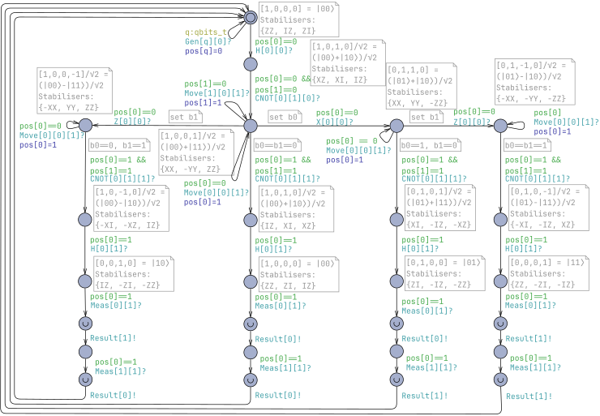
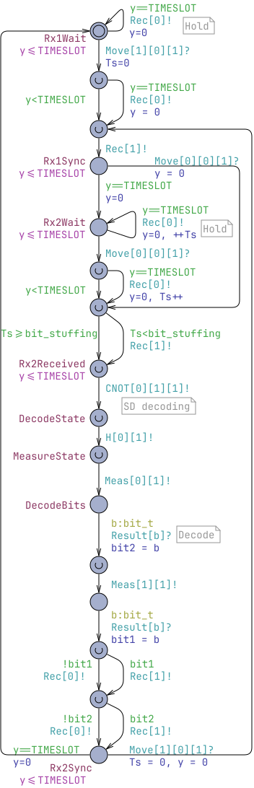
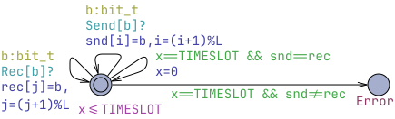
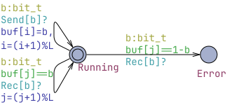
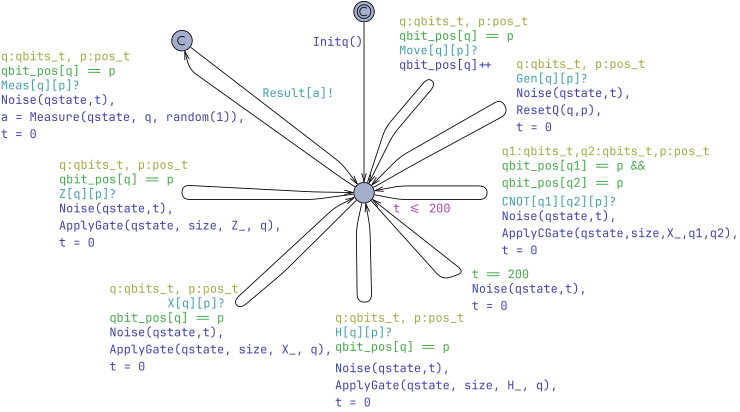
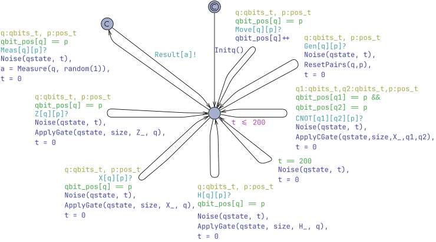
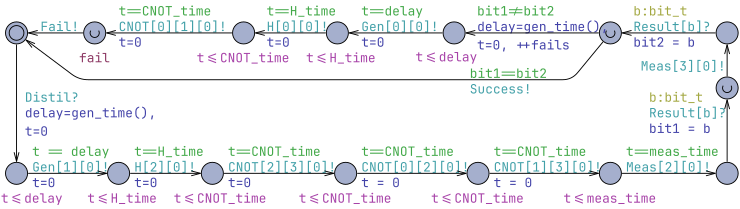
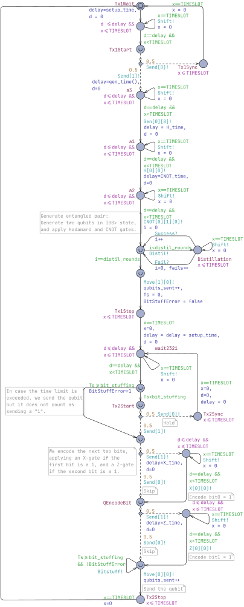

# Analysis and Verification of Quantum Communication Protocols in UPPAAL

_**[Analysis and Verification of Quantum Communication Protocols in UPPAAL](Quantum-CAV26)**_, René Bødker Christensen, Nikolaj Rossander Kristensen, Kim Guldstrand Larsen, Marius Mikučionis, Jiří Srba and Loke Walsted. In: Computer Aided Verification (CAV 2026). [doi:10.1007/978-3-032-32537-2_18](https://doi.org/10.1007/978-3-032-32537-2_18)

Download the entire artifact with instructions in `README.md`: [artifact.zip](artifact.zip)

## Model Previews

### bsdc-enumerated.xml

2-bit quantum process `Quantum2`:

Sender process `SenderTimeslotted`:

Receiver `ReceiverTimeslotted`:

`Monitor` with two buffers:

Monitor with sliding-window buffer (`MonitorOld`):

### bsdc-density-matrix.xml

Quantum process with density matrix operations `Qstate2` for 2 qubits:

Quantum process with density matrix operations `Qstate4` for 4 qubits:

`Distiller`:

Sender with distillation `SenderShifting`:

