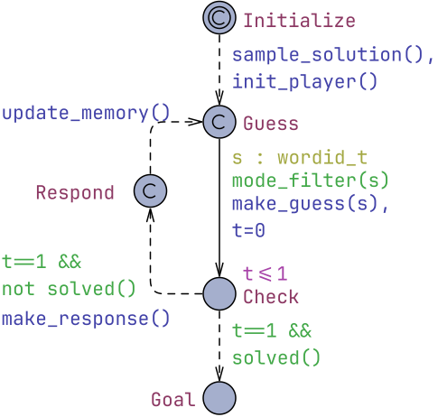

# Playing Wordle with Uppaal Stratego
**Playing Wordle with Uppaal Stratego**, Peter G. Jensen, Kim G. Larsen, Marius Mikučionis. *A Journey From Process Algebra via Timed Automata to Model Learning - A Festschrift Dedicated to Frits Vaandrager on the Occasion of His 60th Birthday*, June 2022.  [doi:10.1007/978-3-031-15629-8_15](https://doi.org/10.1007/978-3-031-15629-8_15) [[pre-print](Playing_Wordle_with_Uppaal_Stratego.pdf)]

The computed strategy is deployed in [WordAAL](https://uppaal.org/wordaal/).

## Abstract

In this paper we model and solve the popular game Wordle using Uppaal  Stratego. We model three different game-modes in terms of POMDPs, with more than 12,000 controllable actions. These constitute by far the largest models ever presented to Uppaal  Stratego. Our experimental evaluation is encouraging: e.g. in the hard game-mode the partitioning-refinement learning method of Uppaal  Stratego reduces the expected number of guesses from a baseline of 7.67 to 4.40 using 1 million training episodes. To better understand the convergence properties of our learning method we also study reduced versions of Wordle.

 - [wordle-english-combined.xml](wordle-english-combined.xml) Wordle running example.


## Wordle Model
Model file: [wordle-english-combined.xml](wordle-english-combined.xml)

### Global Declarations

```cpp
/**
 * The model and queries developed by Peter G. Jensen, Kim G. Larsen and Marius Mikučionis
 * Inspired by Wordle game.
 */
const int NLETTER = 26; // number of letters
const int NPOS = 5;   // number of positions
const int NWORDS = 12972;     // total number of valid words
const int CURATED = 2315;     // number of curated words
const int MAXG = 2000;     // maximum attempted guesses
const int MAXS = MAXG*3+5; // maximum attempted transitions (used in queries)

typedef int[-1, NLETTER-1] letter_t; // number of letters (+ special unknown -1)
typedef int[0, NPOS-1] pos_t;  // position range
typedef int[0,2] res_t;        // response: 0=in-place, 1=present, 2=absent
typedef int[0,NWORDS-1] wordid_t;
clock guesses;
clock t;

letter_t solution[pos_t]; // solution known only to oponent

typedef letter_t guess_t[pos_t];

guess_t guess;    // our attempt at guessing the solution

res_t response[pos_t]; // oponent's response to our guess

const res_t GREEN = 0;
const res_t YELLOW = 1;
const res_t GRAY = 2;

void make_response() {
    int[0,NPOS] counts[letter_t];
    // mark correct positions and count unmarked letters:
    for (p : pos_t)
        if (guess[p] == solution[p])
            response[p] = GREEN;
        else {
            response[p] = GRAY;
            ++counts[solution[p]];
        }
    // mark out of place letters:
    for (p : pos_t) {
        if (response[p] != GREEN) {
            if (counts[guess[p]] > 0) {
                response[p] = YELLOW;
                --counts[guess[p]];
            }
        }
    }
}

bool solved() {
    for (p : pos_t)
        if (guess[p] != solution[p])
            return false;
    return true;
}

const letter_t words[wordid_t][pos_t] = {
	{0,1,0,2,10},     //     0: aback
	{0,1,0,18,4},     //     1: abase
	{0,1,0,19,4},     //     2: abate
    ...
	{25,24,12,8,2}    // 12971: zymic
};

wordid_t solution_index = 0;
void sample_solution() {
//    sol_t s = fint(random(SOLUTIONS)); // uniform distribution over entire dictionary
//    sol_t s = fint((random(SOLUTIONS)+random(SOLUTIONS))/2); // triangular distribution
//    sol_t s = fint(random(SOLUTIONS)/2); // uniform over half dictionary
//    sol_t s = fint(random(SOLUTIONS)/4); // uniform over quarter dictionary
    solution_index = fint(random(NWORDS)); // uniform over curated words
    solution = words[solution_index];
}

void make_guess(wordid_t s) { guess = words[s]; }
```

### Template Play
Local declarations:
```cpp
const bool HARDMODE = true; // enable or disable hardmode
const int STRATEGY_TYPE = 2; // no_restriction=-1, conservative=0, permissive=1, conservative+permissive=2
const int STRATEGY_UNRESTRICTED = -1; // no restrictions
const int STRATEGY_CONSERVATIVE = 0;  // conservative
const int STRATEGY_PERMISSIVE = 1;    // permissive
const int STRATEGY_CONS_PERM = 2; // conservative and permissive
const int MEMORY_TYPE = 0; // matching strategy type=0, historical=1
const int MEMORY_MATCHING = 0;
const int MEMORY_HISTORICAL=1;
const int MIN_NBITS = 100;
const int MAX_NBITS = 130;


bool hard[NWORDS]; // used for caching hardmode words

int[-1,1] knowledge[pos_t][letter_t]; // surely not (-1), maybe (0), surely (1)
const int SURELY_NOT = -1;
const int MAYBE = 0;
const int SURELY = 1;

// general knowledge; the number of occurences of letters and the "green"-hints
int counts[letter_t];
letter_t sure_hints[pos_t];

int max(int a, int b) {
    if (a > b) return a;
    return b;
}

void init_player() {
    assert(MEMORY_TYPE == MEMORY_MATCHING);
    assert(STRATEGY_TYPE >= -1 && STRATEGY_TYPE <= 2);
    // initialize hardmode cache
    if (HARDMODE)
        for (w : wordid_t) 
            hard[w] = true;
    for (p : pos_t)
        sure_hints[p] = -1; // we don't know the exact position of anything
}

// updates memory of number of occurences of specific characters
void update_count() {
    int local_counts[letter_t];
    for (p : pos_t)
        if (response[p] != GRAY)
            local_counts[guess[p]] += 1;
    for (c : letter_t)
        counts[c] = max(counts[c], local_counts[c]);
}

void update_hints() {
    for (p : pos_t)
        if (response[p] == GREEN)
            sure_hints[p] = guess[p];
}

void update_hard() {
    int local_counts[letter_t];
    for (w : wordid_t) {
        if (hard[w]) {
            local_counts = counts;
            for (p : pos_t) {
                if (sure_hints[p] != SURELY_NOT && words[w][p] != sure_hints[p])
                    hard[w] = false; // we did not use the position-hints!
                --local_counts[words[w][p]];
            }
            for (l : letter_t) {
                if (local_counts[l] > 0)
                    hard[w] = false; // we did not use all the hints!
            }
        }
    }
}

// we keep track of ABSENSE of letters here
void update_conservative() {
    for (p : pos_t) {
        if (response[p] == GREEN) {
            for (l : letter_t)
                knowledge[p][l] = SURELY_NOT;
            knowledge[p][guess[p]] = SURELY;
        } else if (response[p] == YELLOW) {
            knowledge[p][guess[p]] = SURELY_NOT;
        } else if (response[p] == GRAY) {
            if (counts[guess[p]] == 0) { // does not appear at all
                for (q : pos_t)
                    knowledge[q][guess[p]] = SURELY_NOT;
            } else {
                knowledge[p][guess[p]] = SURELY_NOT;
                if (forall(q : pos_t)
                        guess[q] != guess[p] || response[q] != YELLOW)
                {   // all are correctly placed
                    for (q : pos_t)
                        if (guess[q] != guess[p] || response[q] != GREEN)
                            knowledge[q][guess[p]] = SURELY_NOT;
                }
            }
        }
    }
}

bool conservative_strategy(wordid_t solution) { // anything that has not proven impossible is allowed
    return not exists(p : pos_t) knowledge[p][words[solution][p]] == SURELY_NOT;
}

void check_sums() {
    int letter_sum;
    letter_t letter;
    int local_counts[letter_t];
    bool changed = true;
    while (changed) {
        changed = false;
        local_counts = counts;
        // check if there is only one unknown letter left
        for (p : pos_t) {
            letter_sum = 0;
            for (l : letter_t) {
                if (knowledge[p][l] != SURELY_NOT) {
                    letter = l;
                    letter_sum += 1;
                }
            }
            if (letter_sum = 1 && knowledge[p][letter] != SURELY) { // new information!
                knowledge[p][letter] = SURELY;
                changed = true;
            }
            if (letter_sum == 1) {
                --local_counts[letter];
            }
        }

        if ((sum(l : letter_t) counts[l]) == NPOS)
            // remove all inconsistent with the 5 known letters
            for (p : pos_t)
                for (l : letter_t)
                    if (knowledge[p][l] != SURELY && counts[l] == 0)
                        knowledge[p][l] = SURELY_NOT;
    }
}


void update_permissive() {
    update_conservative();
    check_sums();
}

bool is_hard(wordid_t solution) {
    int local_counts[letter_t];
    bool ok_green;
    bool used_hints;
    ok_green = forall(p : pos_t)
                   knowledge[p][words[solution][p]] == SURELY ||
                   (not exists(l : letter_t) knowledge[p][l] == SURELY);
    local_counts = counts;
    for(p : pos_t) --local_counts[words[solution][p]];
    used_hints = forall(p : pos_t) local_counts[p] <= 0;
    return ok_green && used_hints;
}


bool permissive_strategy(wordid_t solution) {
    if (forall(p : pos_t) knowledge[p][words[solution][p]] == SURELY)
        return true;
    return exists(p : pos_t) // anything that feasibly improves the knowledge is allowed
        knowledge[p][words[solution][p]] == MAYBE;
}

bool combined_strategy(wordid_t solution) {
    if (forall(p : pos_t) knowledge[p][words[solution][p]] == SURELY) return true;
    return exists(p : pos_t)
        knowledge[p][words[solution][p]] == MAYBE && // anything that feasibly improves the knowledge is allowed
           forall(p : pos_t) knowledge[p][words[solution][p]] != SURELY_NOT; // also must not use characters shown to be useless
}

bool mode_filter(wordid_t solution) {
    if(HARDMODE && !hard[solution]) return false;
    if (STRATEGY_TYPE == STRATEGY_CONSERVATIVE)
        return conservative_strategy(solution);
    else if (STRATEGY_TYPE == STRATEGY_PERMISSIVE)
        return permissive_strategy(solution);
    else if(STRATEGY_TYPE == STRATEGY_CONS_PERM)
        return combined_strategy(solution);
    else return true;
}

void update_memory() {
    update_count();
    update_hints();
    if (STRATEGY_TYPE == STRATEGY_CONSERVATIVE)
        update_conservative();
    if (STRATEGY_TYPE == STRATEGY_PERMISSIVE ||
        STRATEGY_TYPE == STRATEGY_CONS_PERM)
        update_permissive();
    if (HARDMODE)
        update_hard();
}
```



### System Declarations
```cpp
system Play;
```

### Queries
```cpp
strategy S = minE(guesses) [#<=MAXS] {} -> {
Play.observation[0][0],Play.observation[0][1],Play.observation[0][2],Play.observation[0][3],Play.observation[0][4],Play.observation[0][5],Play.observation[0][6],Play.observation[0][7],Play.observation[0][8],Play.observation[0][9],Play.observation[0][10],Play.observation[0][11],Play.observation[0][12],Play.observation[0][13],Play.observation[0][14],Play.observation[0][15],Play.observation[0][16],Play.observation[0][17],Play.observation[0][18],Play.observation[0][19],Play.observation[0][20],Play.observation[0][21],Play.observation[0][22],Play.observation[0][23],Play.observation[0][24],Play.observation[0][25],Play.observation[1][0],Play.observation[1][1],Play.observation[1][2],Play.observation[1][3],Play.observation[1][4],Play.observation[1][5],Play.observation[1][6],Play.observation[1][7],Play.observation[1][8],Play.observation[1][9],Play.observation[1][10],Play.observation[1][11],Play.observation[1][12],Play.observation[1][13],Play.observation[1][14],Play.observation[1][15],Play.observation[1][16],Play.observation[1][17],Play.observation[1][18],Play.observation[1][19],Play.observation[1][20],Play.observation[1][21],Play.observation[1][22],Play.observation[1][23],Play.observation[1][24],Play.observation[1][25],Play.observation[2][0],Play.observation[2][1],Play.observation[2][2],Play.observation[2][3],Play.observation[2][4],Play.observation[2][5],Play.observation[2][6],Play.observation[2][7],Play.observation[2][8],Play.observation[2][9],Play.observation[2][10],Play.observation[2][11],Play.observation[2][12],Play.observation[2][13],Play.observation[2][14],Play.observation[2][15],Play.observation[2][16],Play.observation[2][17],Play.observation[2][18],Play.observation[2][19],Play.observation[2][20],Play.observation[2][21],Play.observation[2][22],Play.observation[2][23],Play.observation[2][24],Play.observation[2][25],Play.observation[3][0],Play.observation[3][1],Play.observation[3][2],Play.observation[3][3],Play.observation[3][4],Play.observation[3][5],Play.observation[3][6],Play.observation[3][7],Play.observation[3][8],Play.observation[3][9],Play.observation[3][10],Play.observation[3][11],Play.observation[3][12],Play.observation[3][13],Play.observation[3][14],Play.observation[3][15],Play.observation[3][16],Play.observation[3][17],Play.observation[3][18],Play.observation[3][19],Play.observation[3][20],Play.observation[3][21],Play.observation[3][22],Play.observation[3][23],Play.observation[3][24],Play.observation[3][25],Play.observation[4][0],Play.observation[4][1],Play.observation[4][2],Play.observation[4][3],Play.observation[4][4],Play.observation[4][5],Play.observation[4][6],Play.observation[4][7],Play.observation[4][8],Play.observation[4][9],Play.observation[4][10],Play.observation[4][11],Play.observation[4][12],Play.observation[4][13],Play.observation[4][14],Play.observation[4][15],Play.observation[4][16],Play.observation[4][17],Play.observation[4][18],Play.observation[4][19],Play.observation[4][20],Play.observation[4][21],Play.observation[4][22],Play.observation[4][23],Play.observation[4][24],Play.observation[4][25]
}: <>Play.Goal

// With learned knowledge:
E[#<=MAXS;1000](max:guesses*Play.Check) under S

// Without knowledge (random guesses)
E[#<=MAXS;2000](max:guesses*Play.Check)

Pr[<=MAXS] (<> Play.Goal && guesses <= 6)
sup {Play.Check} : guesses
inf {Play.Goal} : guesses
```
